# How Computational Neuroscience Changed Its Mind

### Two decades of CNS meeting abstracts show a field pulled between its biophysical roots and the machine-learning wave — and reveal how it differs from its sister community, CoSyNe.

*Draft for Substack · analysis of 5,394 CNS/OCNS meeting abstracts, 2007–2025*

---

Every summer, a few hundred computational neuroscientists meet at the CNS meeting —
the annual conference of the Organization for Computational Neuroscience — and post a
few hundred abstracts describing what they're working on. Do that for nineteen years
and you accumulate something valuable: a running, unedited transcript of what a whole
scientific community thinks is worth doing.

I assembled that transcript. It's **5,394 abstracts spanning 2007 to 2025** — every
poster, talk, and keynote I could recover and parse into a clean, structured record
(title, authors, affiliations, and the full abstract body). Then I asked a simple
question: *what has this field been talking about, how has that changed, and how does
it differ from the neighbouring community it's most often compared to — CoSyNe, the
Computational and Systems Neuroscience meeting?*

The short version: computational neuroscience is having an identity negotiation. Its
oldest vocabulary — spikes, dendrites, synaptic plasticity — is quietly receding. A
newer vocabulary — manifolds, dimensionality, deep networks, and, since 2023, large
language models — is rising fast. But it is *not* becoming CoSyNe. On three shared
measuring sticks — vocabulary, concept co-occurrence, and author geography — CNS remains
the mechanistic, biophysical wing of the field, while CoSyNe owns behaviour, cortex, and
primates, wires its concepts together differently, and is both the bigger meeting (~1.5×)
and the more American one (54% US authors, to CNS's European anchor). Two communities, two
vocabularies.

Here's what the data shows.

---

## 1. The machine-learning wave

Start with the story everyone expects, because the data tells it emphatically. If you
count how often machine-learning vocabulary appears in CNS abstracts — normalised to
mentions per 10,000 words, so longer abstracts don't inflate the numbers — the trend
is a clean upward sweep.

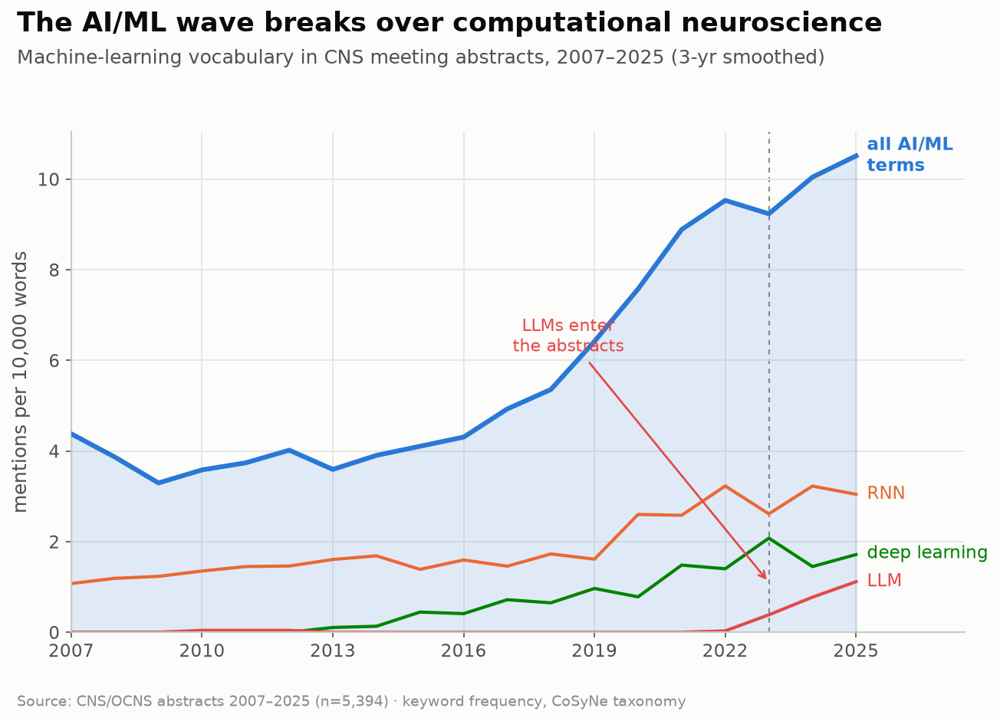

*Machine-learning vocabulary roughly **doubled** as a share of CNS abstract text
between 2007 and 2025 — from about 4.4 mentions per 10,000 words to 10.5. Individual
methods enter in waves: deep learning from ~2015, recurrent neural networks (RNNs)
jumping after 2019, and large language models appearing essentially from a standing
start in 2023.*

What's striking isn't just the rise but its *staging*. Deep learning arrives first, in
the mid-2010s. RNNs surge at the end of the decade, as recurrent networks become the
default model organism for studying neural dynamics. And then LLMs show up in 2023 —
not gradually, but as a discontinuity, going from near-zero to a visible presence in a
single year. The field's vocabulary now has a timestamp on it.

---

## 2. What rose, and what quietly left the room

The machine-learning story is the loud one. The more interesting story is what got
*displaced*. If I take every keyword the analysis tracks and compare its average
intensity in the early years (2007–2011) against the most recent (2021–2025), a clear
rotation appears.

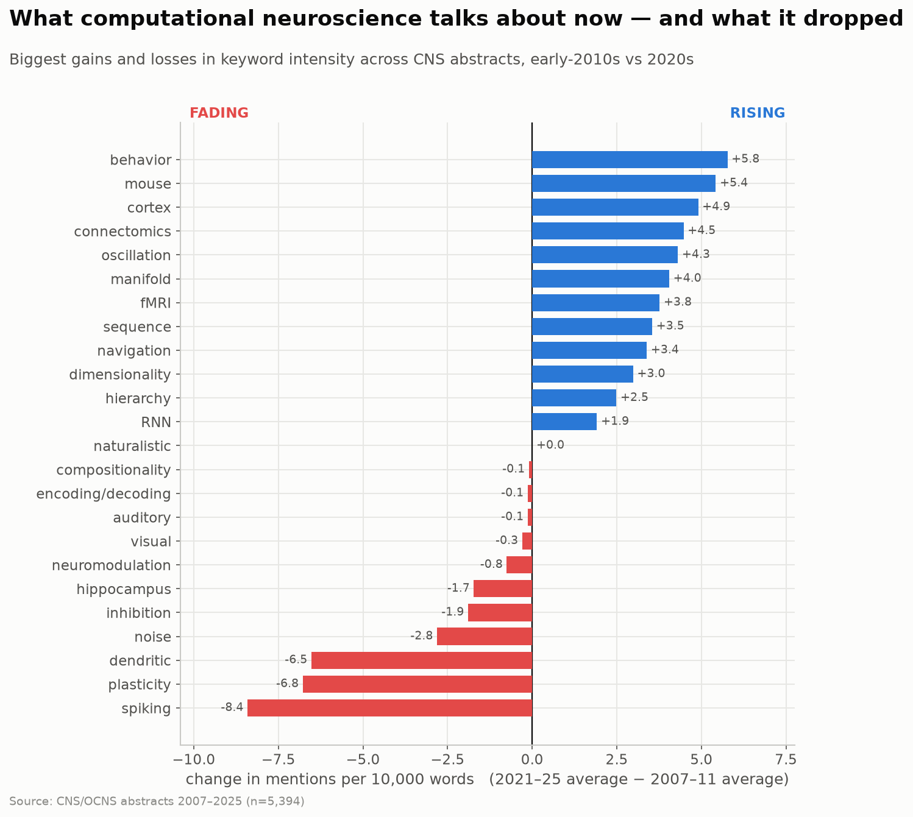

*The biggest gainers and losers in keyword intensity. Rising terms cluster around
population/geometry language and systems-neuroscience tooling; the sharpest declines
are the field's classic single-neuron biophysics vocabulary.*

Read the two columns and you can see the field turning:

- **On the way up:** `behavior`, `mouse`, `cortex`, `connectomics`, `manifold`,
  `fMRI`, `dimensionality`, `navigation`. This is the signature of the "population
  turn" — the shift from asking what a single neuron computes to asking what the
  *geometry* of a whole population's activity looks like — fused with the mouse-plus-
  large-scale-recording toolkit that now dominates experimental systems neuroscience.
- **On the way out:** `spiking`, `plasticity`, `dendritic`, `noise`, `inhibition`,
  `hippocampus`. This is the classic biophysical core of computational neuroscience —
  the detailed, mechanistic modelling of how individual neurons and synapses work.

None of these terms have *disappeared*. But the field's attention has visibly rotated,
away from the spike and toward the manifold. The supplementary "vocabulary map" at the
end of this piece makes the rotation vivid: a whole block of terms — LLM, transformer,
foundation model, connectomics, manifold — lights up only in the last few years, while
the biophysics block glows brightest in the 2000s.

---

## 3. Two communities, two vocabularies

Computational neuroscience is often discussed alongside **CoSyNe**, the Computational
and Systems Neuroscience meeting. The two are sometimes treated as interchangeable.
They are not — and because an earlier study measured CoSyNe with *exactly* the same
keyword taxonomy I used here, the two can be placed on a single shared axis and
compared directly.

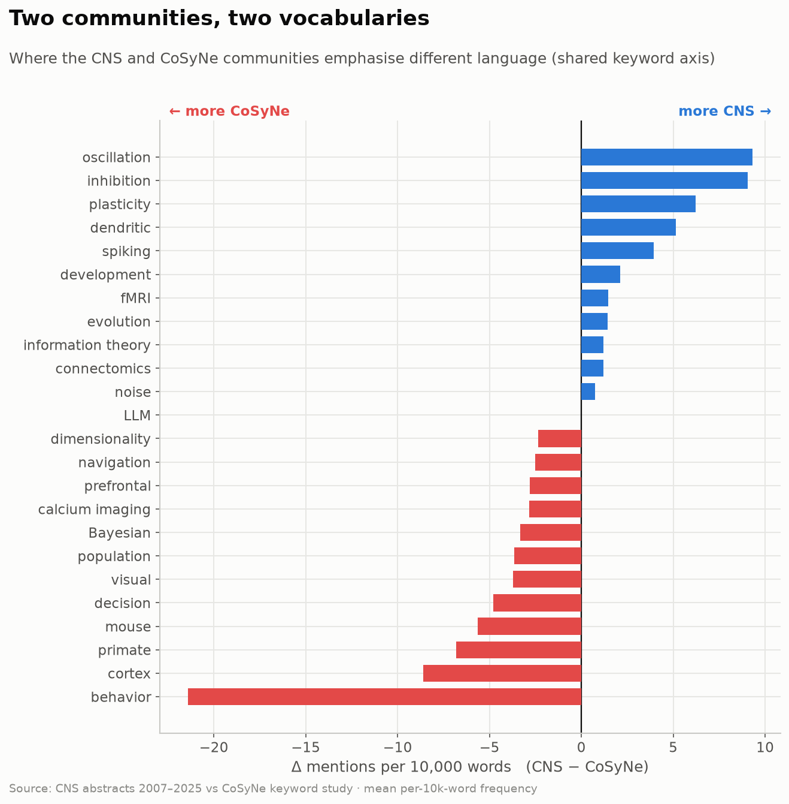

*Each bar is the difference in a term's average intensity between the two meetings.
Blue = a word CNS uses more; red = a word CoSyNe uses more.*

The contrast is sharp and coherent:

- **CNS is the mechanistic community.** It leans hard on `oscillation` (+9.3 per 10k
  relative to CoSyNe), `inhibition` (+9.1), `plasticity` (+6.2), `dendritic` (+5.1),
  and `spiking` (+4.0) — the language of circuits and biophysics.
- **CoSyNe is the systems-and-behaviour community.** It dominates `behavior` (a
  remarkable +21.4 the other way), `cortex`, `primate`, `mouse`, `decision`,
  `population`, `visual`, and `Bayesian` — the language of what animals do and how
  cortex represents it.

So even as CNS *modernises* — picking up manifolds, mice, and deep networks — it
retains a distinct centre of gravity. The two meetings are not converging into one
NeuroAI blob; they are specialising. CNS is where the mechanism lives; CoSyNe is where
the behaviour lives.

But *how much* do they actually overlap — and does the divergence survive once you
correct for the fact that the two meetings simply talk at different volumes? Two
representations sharpen the answer.

First, the field's own internal structure. If you link every keyword to every other
keyword whose year-by-year trajectory rose and fell in step with it, and then let a
community-detection algorithm find the clusters, computational neuroscience organises
itself into a handful of coherent families:

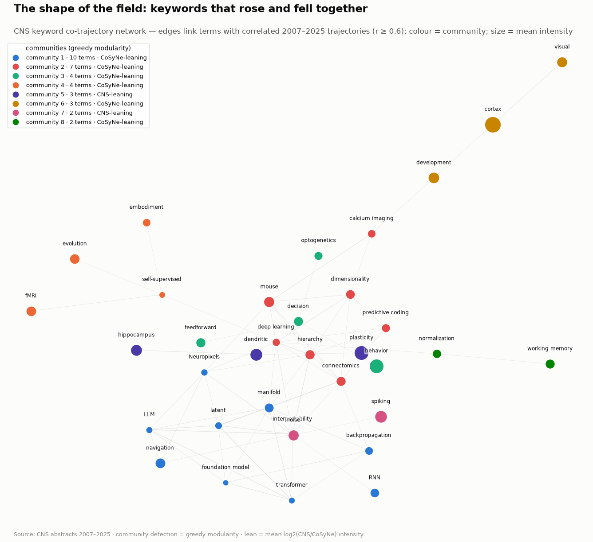

*Terms that trended together, 2007–2025. Two things stand out. The large blue/red
clusters at the bottom — `LLM`, `transformer`, `manifold`, `latent`, `Neuropixels`,
`connectomics`, `deep learning`, `dimensionality` — are the modern "NeuroAI + geometry"
families that all switched on together; on the shared axis they lean **CoSyNe**. The
small purple and pink clusters — `plasticity`/`dendritic`/`hippocampus` and
`spiking`/`noise` — are the classic biophysics families, and they lean **CNS**. The
field's newest vocabulary and its oldest vocabulary form structurally distinct
communities, and those communities have different homes.*

Second, the overlap itself — measured properly. The raw-frequency view (above) is
dominated by a few high-volume umbrella words. If instead I express each community's
vocabulary as *shares of its own total* — taking scale out entirely — I can measure how
much the two fields genuinely have in common, and which terms each one over-uses
*relative to its own size*.

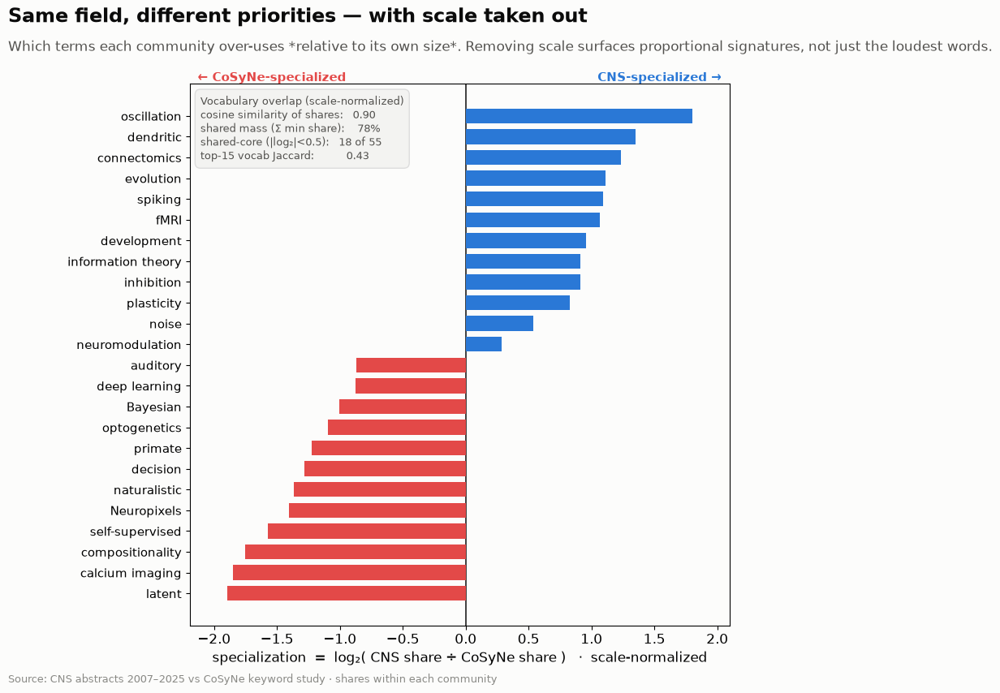

*The two vocabularies are **broadly shared but distinctly weighted**: the cosine
similarity of their keyword-share profiles is 0.90 and 78% of the total vocabulary
"mass" is common ground — yet fewer than half of each community's top-15 terms are
shared (Jaccard 0.43), and only 18 of 55 tracked terms sit in the neutral shared core.
Taking scale out also **changes which terms define each community.** CoSyNe's
proportional signatures are not the loudest words but the newest ones — `latent`,
`calcium imaging`, `Neuropixels`, `self-supervised`, `compositionality`. CNS's are its
mechanistic core — `oscillation`, `dendritic`, `connectomics`, `spiking`. The headline
"behaviour vs biophysics" split is real, but the sharper, scale-free story is
"emerging-methods community vs mechanism community."*

A compact way to see the same thing per term is to plot every keyword by how intensely
each meeting uses it:

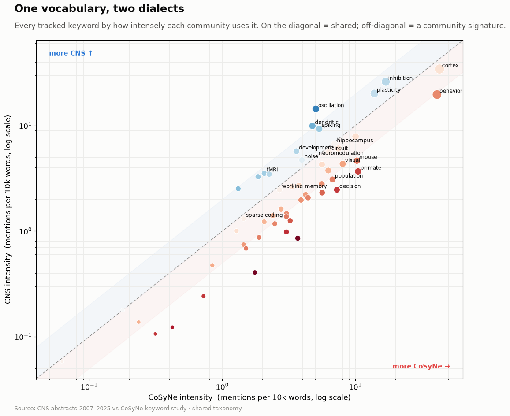

*Points on the diagonal are shared; points above are CNS signatures (oscillation,
inhibition, plasticity, dendritic, spiking), points below are CoSyNe signatures
(behaviour, cortex, primate, mouse, decision). It's one vocabulary spoken in two
dialects.*

That specialisation shows up most clearly in how the two communities took to machine
learning.

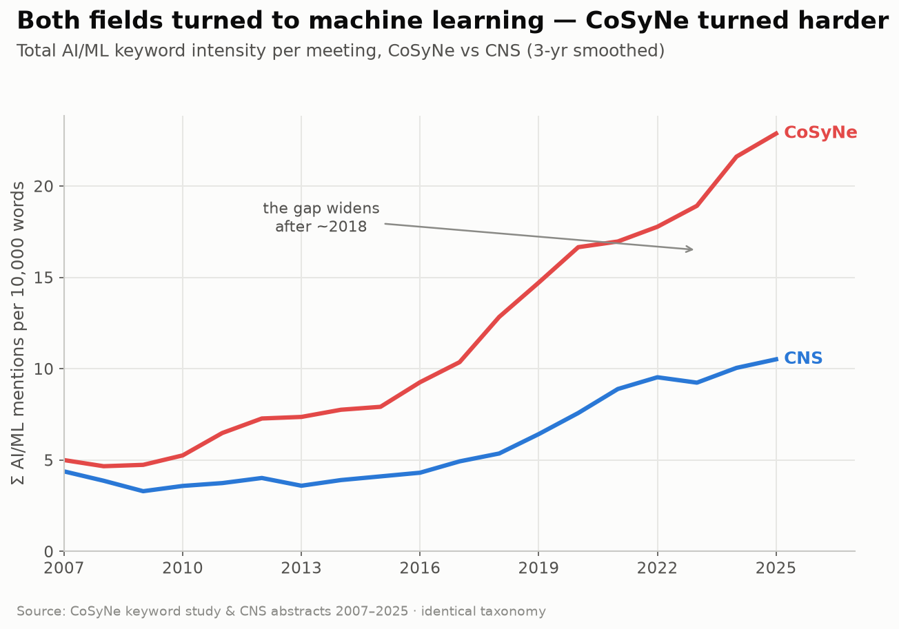

*Both meetings turned toward machine learning from the mid-2010s — but CoSyNe turned
harder and earlier, and the gap has widened since ~2018.* By 2025, machine-learning
vocabulary is more than **twice** as dense in CoSyNe abstracts (~23 per 10k) as in CNS
abstracts (~10.5 per 10k). This is exactly what you'd expect if CoSyNe sits closer to
the NeuroAI frontier while CNS keeps one foot planted in biophysics.

**Do the two fields wire concepts together the same way?** Sharing a vocabulary is not
the same as organising it the same way. Building a true co-occurrence network for each
meeting — linking two keywords when they appear in the same abstract more often than
chance (NPMI ≥ 0.2), then letting community detection find the clusters — shows that the
two fields partition even their *shared* vocabulary quite differently.

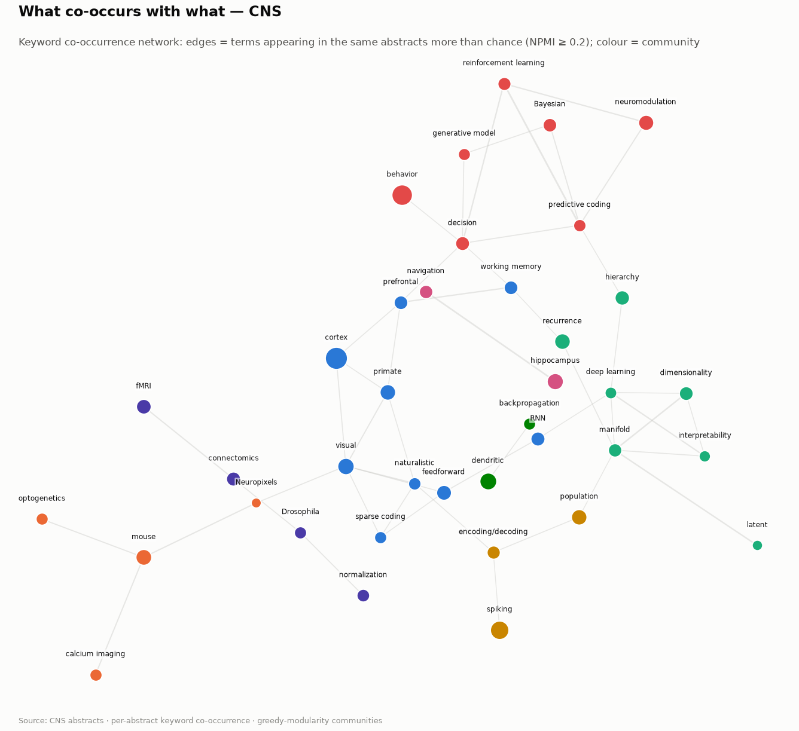

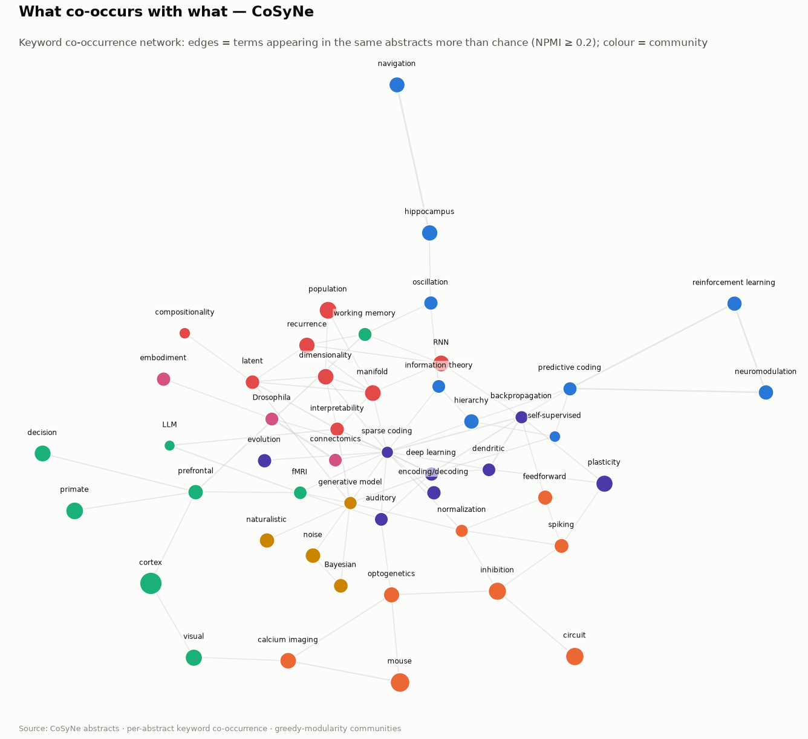

*Two structural differences stand out. CoSyNe's network is markedly **denser** — 48
connected terms and 86 above-chance links, against CNS's 38 terms and 49 links — so its
concepts co-occur more promiscuously across topics. And the clusters don't line up: on
the 36 keywords both fields use, the two partitions share only a **Jaccard of 0.21** of
their within-cluster keyword pairs. Concretely, CNS keeps a tight biophysical cluster
(`population`, `spiking`, `encoding/decoding`) apart from its AI-geometry cluster
(`deep learning`, `manifold`, `dimensionality`, `interpretability`); CoSyNe instead folds
`population` into a representational-geometry cluster (`manifold`, `latent`, `recurrence`,
`RNN`) and pairs `deep learning` with learning mechanisms (`backpropagation`, `dendritic`,
`plasticity`). Same words, different wiring — CNS reasons from mechanism outward, CoSyNe
from representation outward.*

---

## 4. A field that keeps going more global

Trends in *ideas* are the headline, but the abstracts also record *who* is doing the
work. Parsing author affiliations into countries, the meeting looks steadily — if
noisily — more international over time.

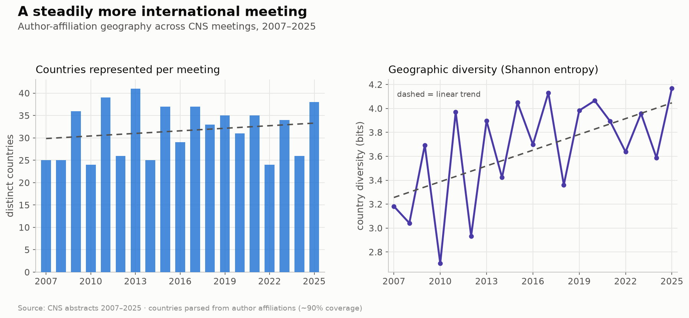

*The number of distinct countries at each meeting bounces between 24 and 41, and the
geographic diversity (measured as Shannon entropy over countries) drifts upward from
about 3.2 bits in 2007 to 4.2 in 2025. The dashed lines are the linear trends — modest,
but positive on both measures.*

The year-to-year noise is real and has a mundane cause: the CNS meeting is held in a
different city each year, and the host country reliably brings a home-team bump. That
same effect dominates the country-by-country view:

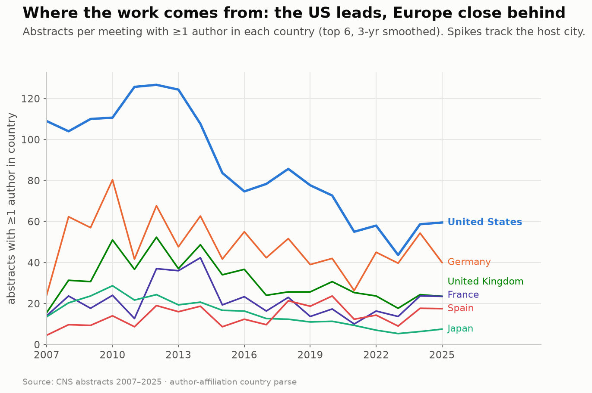

*The United States leads every meeting, with Germany, the UK, France, Spain, and Japan
forming the next tier. The spikes track host cities — the big US peaks in 2010, 2012,
and 2018 line up with US-hosted meetings.* The raw counts fall for the US over the
period partly because several early meetings were US-hosted; the more robust signal is
the *broadening base* captured by the rising diversity in the previous figure.

There's a sharper way to put this. The US is the single largest *country* at CNS — but
Europe, taken as a bloc, is the largest *region*, and by a growing margin.

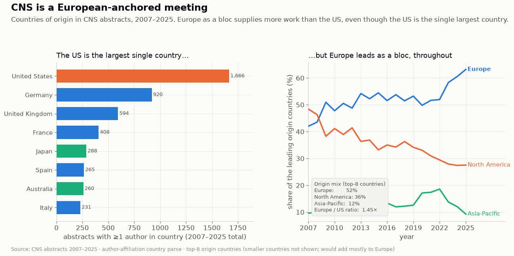

*Among the eight leading origin countries, Europe (Germany, UK, France, Spain, Italy)
accounts for ~52% of the work to North America's ~36% — a ratio of about 1.45×, and one
that widens over time: Europe's share of the leading countries climbs from ~42% in 2007
to ~63% by 2025 while North America's falls from ~48% to ~28%. (Smaller countries are
omitted here; adding them would mostly reinforce Europe.) **CNS is, in origin, a
European-anchored meeting.**

Which institutions supply all this work? Parsing every affiliation to an institution
name, the most active labs are a recognisable mix of European and North-American
centres:

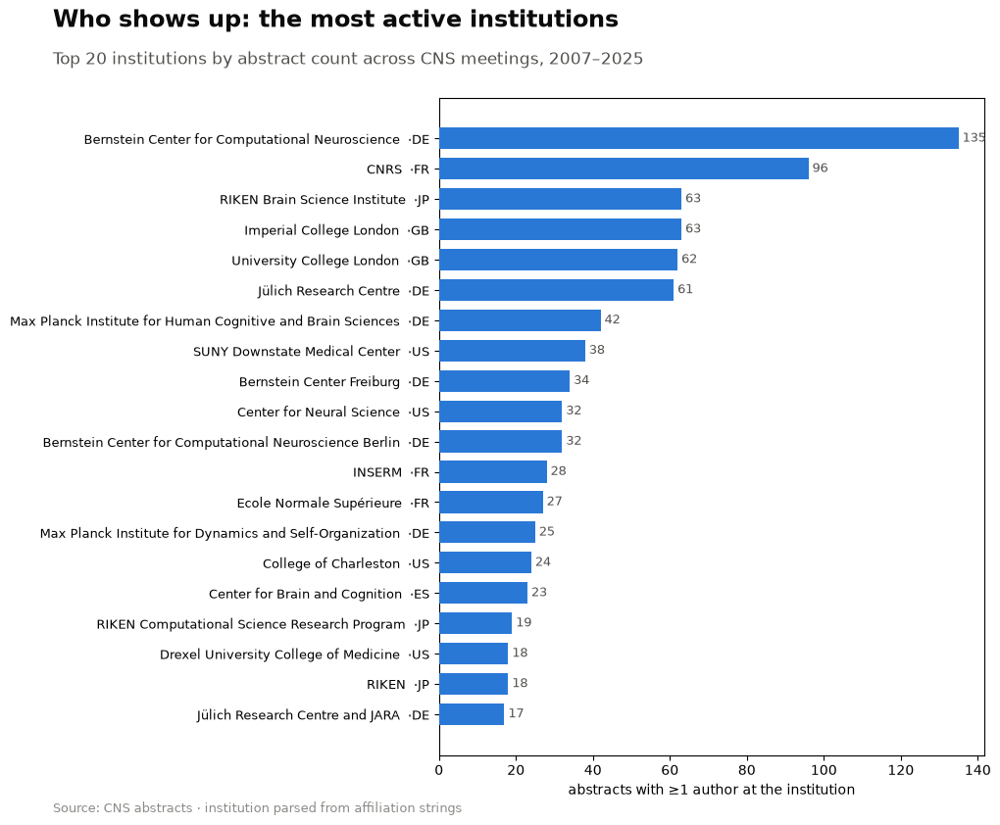

*Top institutions by abstract count across all CNS meetings. The Bernstein network of
computational-neuroscience centres, CNRS, University College London, Imperial College
London, the Jülich Research Centre, RIKEN, and the Max Planck institutes anchor the
list — a European centre of gravity that matches the country picture.* Linking
institutions that co-author together traces the field's collaboration backbone
(`fig12`), a small set of densely connected hubs surrounded by a long tail of
occasional collaborators.

## 5. CoSyNe is bigger — and more American

Computational neuroscience is most often compared to **CoSyNe**, its sister meeting. The
comparison is usually made from memory; here it can be made from the data. Two things
that "everyone knows" about CoSyNe — that it's bigger, and that it's more American — both
check out.

First, size. Counting accepted abstracts (posters + talks) year by year, CoSyNe is the
larger meeting and the gap is widening.

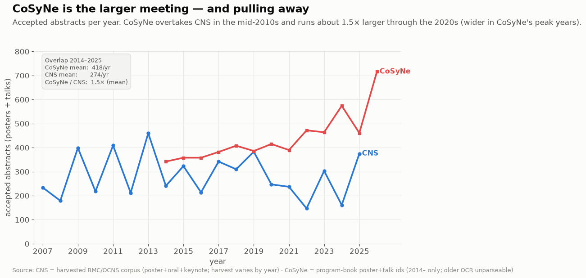

*Accepted abstracts per year. CoSyNe overtakes CNS in the mid-2010s and runs about
**1.5× larger** across 2014–2025 (≈418 vs ≈274 abstracts a year), reaching ~720 accepted
abstracts by 2026. CNS's line is noisier — meeting size genuinely fluctuates, and corpus
harvest completeness varies by year — but the direction is unambiguous.*

Second, geography — the "CoSyNe is US, CNS is EU" hypothesis. Earlier this could only be
half-answered, because the project ingested CoSyNe as keyword frequencies with no author
affiliations. Parsing CoSyNe's program books directly and resolving each abstract's
institutions to countries closes the gap, and the two communities turn out to mirror each
other:

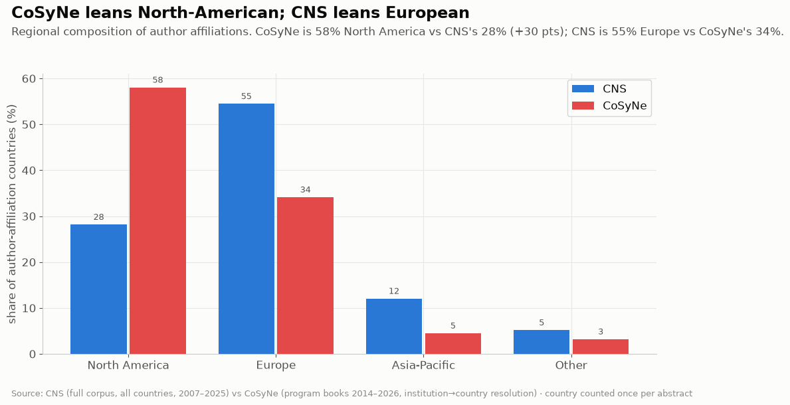

*Regional composition of author affiliations, both sides resolved institution-by-
institution (CNS: full corpus, 2007–2025; CoSyNe: program books, 2014–2026, at 97%
per-abstract coverage). CoSyNe draws **58% of its author-affiliation countries from North
America** — the United States alone accounts for **54%** — and just **34% from Europe**.
CNS is the inverse: **28% North America, 55% Europe**. The US is the single largest
country at both meetings, but it is a *plurality* at CNS and an outright *majority* at
CoSyNe.* On origin, CNS is European-anchored and CoSyNe is American-anchored — exactly as
the folklore holds, now with the receipts.

---

## 6. A note on method — and why the full abstract matters

It would have been far easier to run all of this on abstract **titles** alone; titles
are trivially available, while full abstract bodies took real work to recover and
parse. So before trusting any of the above, I checked whether it would have mattered.

It matters a lot.

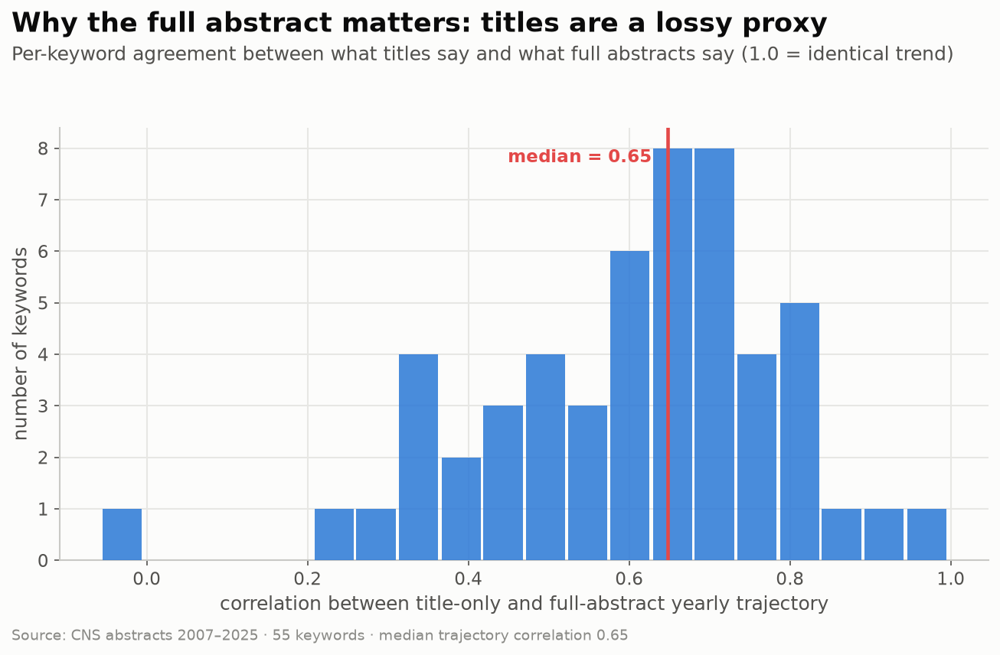

*For each keyword, I measured how well its year-by-year trajectory computed from titles
alone agrees with the trajectory computed from full abstracts. A correlation of 1.0
means titles tell the same story as the full text. The median is just **0.65**, and
38 of 55 keywords fall below 0.70.* A title-only version of this analysis would have
drawn measurably different conclusions. Depth was worth the effort — a useful caution
for anyone tempted to do scientometrics on titles or metadata alone.

**How the numbers are built.** Every term is a small dictionary of synonyms (for
example, `plasticity` counts *plasticity, synaptic plasticity, hebbian, LTP, LTD,
STDP*), counted across all abstract text in a year and divided by the total word count,
times 10,000. This is deliberately the *same* recipe the earlier CoSyNe study used, so
the two communities are measured identically. It also inherits that recipe's known
quirk: overlapping synonyms are counted separately, so broad umbrella words
(`cortex`, `oscillation`) run higher than narrow ones. The comparison between years and
between meetings is apples-to-apples; the absolute magnitude of any single term should
be read as an index, not a literal count.

Beneath the keyword counts, a data-driven topic model (BERTopic over sentence
embeddings of every abstract) independently recovers ~38 coherent themes — visual
cortex, decision/reward, functional connectivity, gamma synchronisation,
seizure/epilepsy, cerebellar modelling, and more — and shows the same rotation:

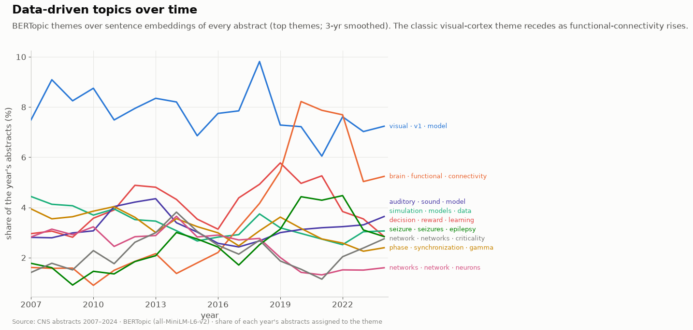

*Share of each year's abstracts assigned to the top BERTopic themes (3-yr smoothed). The
functional-connectivity/fMRI theme rises across the period while the classic visual-cortex
theme recedes from its early dominance.* The keyword story isn't an artifact of the
dictionary; the abstracts cluster that way on their own.

---

## What it adds up to

Nineteen years of abstracts describe a field in motion but not in crisis. Computational
neuroscience is absorbing machine learning wholesale, rotating from single-neuron
biophysics toward population geometry, and drawing contributors from an ever-wider set
of countries. Yet it has kept its identity: measured against CoSyNe on the same ruler,
CNS is still unmistakably the community of mechanism — oscillations, inhibition,
plasticity, dendrites — while its sister meeting owns behaviour and cortex.

The most telling data point may be the smallest: the letters **LLM**, absent from the
corpus for sixteen years, appearing abruptly in 2023 and climbing since. Every field is
being asked what it will do about large language models. Computational neuroscience has
started to answer in its abstracts — and we now have the receipts to watch it happen.

---

*Methods, data, and every figure in this piece are fully reproducible. The corpus spans
5,394 abstracts across 19 CNS/OCNS meetings (2007–2025); geography is parsed from author
affiliations at ~90% coverage; keyword frequencies follow the CoSyNe taxonomy for
comparability. The CoSyNe comparison now runs on three shared rulers — keyword intensity,
per-abstract keyword co-occurrence, and institution-resolved geography — from CoSyNe's own
program books (per-abstract structure recoverable 2014–2026). Aggregate tables and the
figure-generation code are open; raw abstract text is not redistributed. Interactive
(Datawrapper) versions of the topic, meeting-size, geography, AI-uptake and keyword-change
charts are listed in `results/datawrapper/README.md`. Caveats: keyword magnitudes are
indices (see method note); CNS country counts are host-city-sensitive; the CoSyNe
institution→country map covers 97% of abstracts, with the unresolved tail (bare department
names) left uncounted rather than guessed.*

---

### Appendix — the full vocabulary map

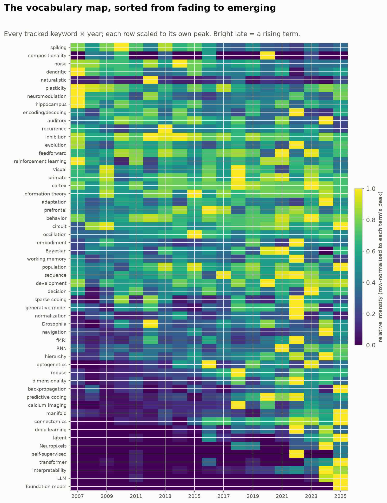

*Every tracked keyword (rows) across every year (columns), with each row scaled to its
own peak intensity and rows sorted from "faded early" at the top to "emerged late" at
the bottom. The bright band in the bottom-right corner — LLM, transformer, foundation
model, self-supervised, connectomics, manifold — is the field's newest vocabulary
switching on in real time.*
